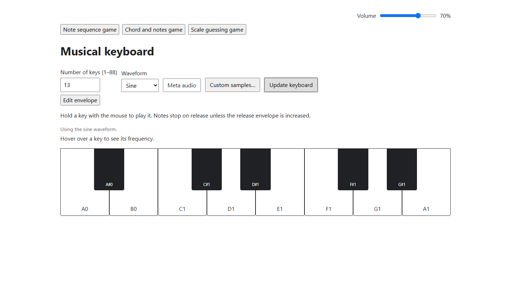
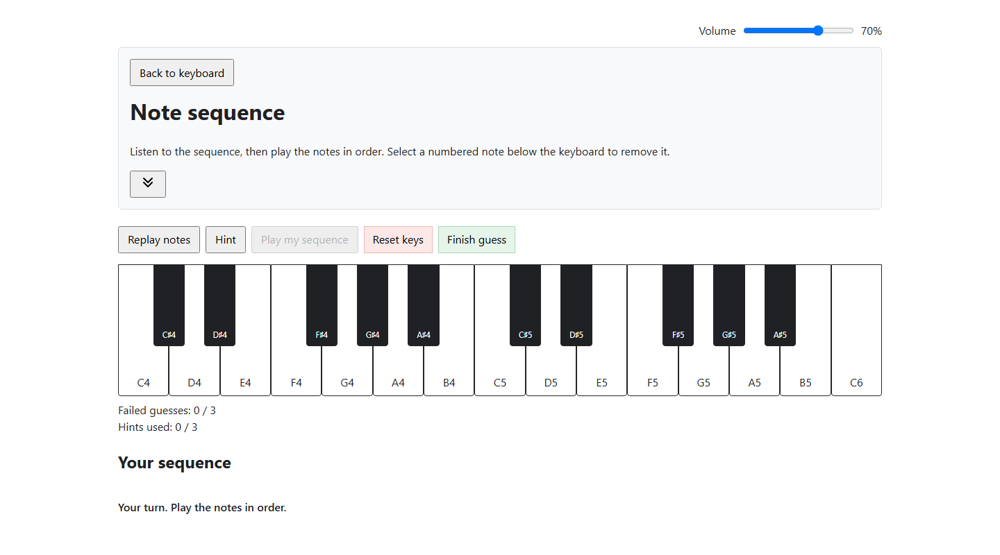

# Learning by Ear

! Currently AI generated description, everything is work in progress !!

## Introduction

Learning by Ear has two purposes: learning agentic coding and learning music theory, with a focus on ear training. The generated `dist/index.html` runs in your browser and sends no user data; selected remote instruments download audio samples on demand.

## Content

### Playing

Play notes on a configurable 1–88-key keyboard. Choose a sine, square, or sawtooth waveform, a piano or guitar instrument, or your own sample directory; adjust the volume and note envelope to shape the sound.

### Games

#### Note sequence

Listen to a sequence and play it back in the same order. Choose its length and whether note lengths are randomized.

#### Chord and notes

Identify a chord by sound, find its notes on the keyboard, or identify three random notes.

#### Scale guessing

Identify a scale by sound or play its notes on the keyboard in order.

## Deployment

The GitHub Actions workflow builds and deploys `dist/` to GitHub Pages when changes are pushed to `main`. In the repository settings, set GitHub Pages' build and deployment source to **GitHub Actions**.

## Contribution

This repository is programmed mainly using free GitHub Copilot accessible within VS Code. It records prompts in /prompts automatically by command present in agents.md. Since it uses free models, the code quality really suffers (However I am not sure whether frontiers are really better in this regard, since I do not have experience with them, amybe they are just better in the "it just works" area and the code quality is really the same). So you can for this repository and rerun the prompts using some better model for better results. I plan on manually adding some scales and chords and adding what I learned about them, since this is mainly learning tool, that is I will focus on the music/ear learning on the technical aspects, so once the program will be ergonomic enough and contain exactly what I want I will extend it only through these "learning" manual contributions that help me understand the music better and the technical side will stay the same. So if you won't be happy with the technical side it will probably be better if you jsut fork, since I am not sure about accepting other contributions (I do not want to read AI generated code to check for possible malware-like behavior)
